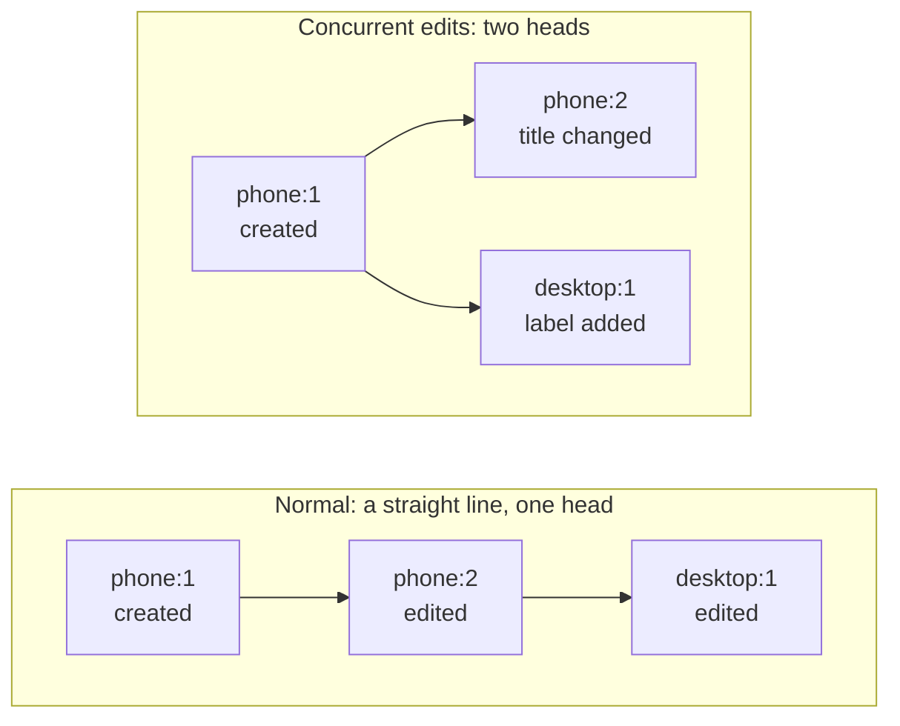
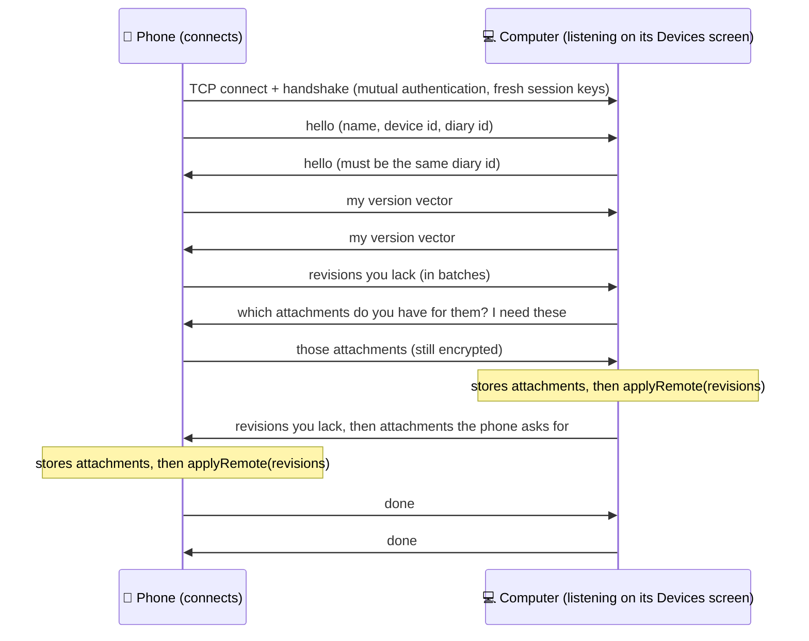
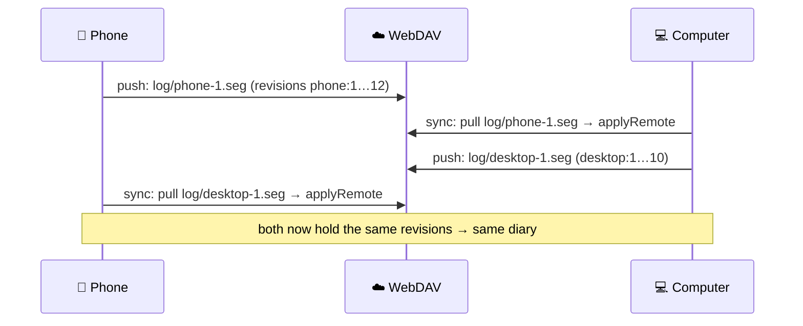
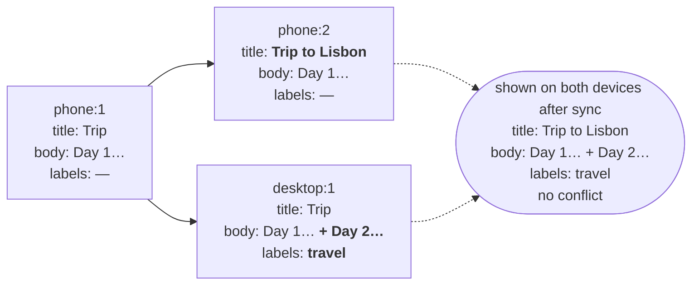
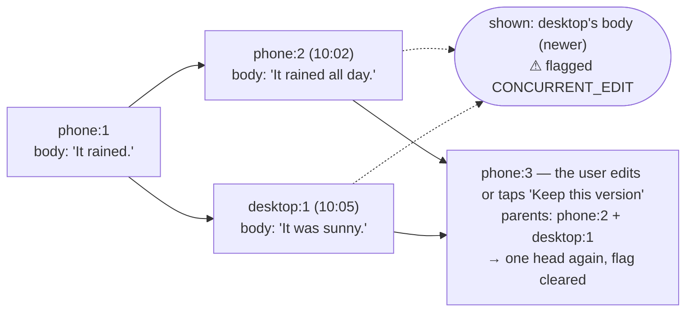

# History, sync and merging

This is the core of secrt: how a change is recorded, how two devices find out what the other is
missing, and what happens when both changed the same thing.

## 1. Records and revisions

The diary has three kinds of **records**: entries, folders and labels. Each has a random id (a
UUID). A record is never edited in place. Instead, every version of it is stored as a
**revision**:

| Field | Meaning |
|---|---|
| `id` | `"<deviceId>:<seq>"`: the device that wrote it and that device's counter (1, 2, 3, … with no gaps) |
| `recordType`, `recordId` | Which record this is a version of |
| `parents` | The revision(s) this one was based on. Usually one; several when it settles a conflict; none for the first version |
| `hlc` | When it was written: a *hybrid logical clock* timestamp (see below) |
| `payload` | The record's full content as JSON (title, body, date, folder, labels, attachments…), or nothing for a **deletion** (a *tombstone*) |

Each revision stores the **whole** record, not a diff, so any revision can be read on its own.
Diary text is small, so keeping every version is cheap, and it gives an entry's history for free.
A screen to browse that history is in the backlog.

The `entry`, `folder` and `label` tables the UI reads are **derived** from the revisions. After
any change, `DiaryStore.materialize` recomputes the affected record from all of its revisions. If
those tables were thrown away, they could be rebuilt exactly.

### Revisions of one record form a graph

Revisions point at their parents, so the history of one record is a small graph, like git
commits. The revisions nobody points at yet are the **heads**:

- **One head:** the normal case. The record's value is that head.
- **Several heads:** two devices changed the record without seeing each other's change. The
  record's value is the *merge* of the heads (section 4).



### Writing a revision

When you save, `DiaryStore.commit`:

1. Loads the record's revisions and finds the current heads.
2. Does nothing if the content didn't change.
3. Otherwise writes a new revision whose `parents` are **all current heads**. If there were
   several heads (a conflict), this new revision joins them and the record has a single head
   again. **Editing a conflicted entry is what resolves the conflict.**
4. Re-derives the record for the UI.

**Amending instead of adding.** Saving every few seconds while typing would create hundreds of
revisions. So if the newest revision:

- was written by this device,
- is less than 5 minutes old, and
- **has never left this device**,

then the save overwrites that revision instead of adding one. You get about one revision per
editing session.

The "never left this device" condition is the **shared watermark**. Every time revisions are
read for sending anywhere (LAN, backup, export), `DiaryStore.revisionsSince` records the highest
`seq` of this device it handed out. A revision at or below that mark is never changed again.
This rule is what makes sync safe: once another device may hold `phone:7`, `phone:7` means the
same thing forever.

### The hybrid logical clock (HLC)

Each revision gets a timestamp `(millis, counter, deviceId)`.

- `millis` follows the wall clock, but never goes backwards: if the clock is behind the latest
  timestamp the device has seen, it stays on that timestamp and increments `counter` instead.
- When a device receives revisions, it moves its clock forward past them (`HlcClock.observe`).
  So a revision written *after* seeing another always gets a later timestamp, even if the two
  devices' clocks disagree by a few minutes.
- `deviceId` breaks the last ties, so no two timestamps are equal and every device sorts
  revisions the same way.

Timestamps decide "which one is newer" in merges. They never decide what is missing; that is the
version vector's job.

## 2. Knowing what the other side is missing: version vectors

Each device numbers its own revisions 1, 2, 3, …, and revisions are immutable once shared. So a
device can summarize everything it holds as **"from each device, everything up to seq N"**. That
summary is the **version vector**:

```
phone's vector:    { phone: 12, desktop: 7 }
desktop's vector:  { phone: 9,  desktop: 10 }
```

Comparing the two tells each side exactly what to send. The desktop lacks `phone:10…12`, and the
phone lacks `desktop:8…10`. There are no timestamps to compare and no full listing of revisions,
and it works with any number of devices.

## 3. Syncing

Every transport does the same three things:

1. learn the other side's version vector;
2. send the revisions it lacks (`DiaryStore.revisionsSince`), plus the attachments they
   reference that it doesn't have;
3. on the receiving side, store them (`DiaryStore.applyRemote`) and re-derive every record they
   touch.

`applyRemote` ignores revisions it already has, so syncing the same thing twice, or in a
different order, or through two paths (LAN and cloud), is harmless. Two devices that hold the
same set of revisions always show the same diary.

### Over the local network (phone ↔ computer)



Attachments are stored before the revisions that reference them. If the connection drops halfway,
the device never ends up with an entry pointing at an attachment that no later sync would send.
The channel itself is described in [architecture.md](architecture.md#lan-pairing--sync-corelan-uidevices).

### Through a cloud backup

The backup is just another replica, except that nobody runs code on it. Each device writes
**only its own files**, so there is never a write conflict on the server:

```
secrt/<diaryId>/
  manifest.json
  vault.key
  log/<deviceId>-1.seg     ← one segment per push, numbered, never rewritten
  log/<deviceId>-2.seg
  log/<otherDevice>-1.seg
  blobs/<attachmentId>     ← attachments, encrypted exactly as on the devices
```

- **Push** writes a new segment with the revisions the backup lacks (as far as this device
  knows), after uploading missing attachments.
- **Pull** downloads the segments this device hasn't read yet and applies them with
  `applyRemote`.
- **Sync** pulls, then pushes.

What this device knows about the backup (which segments it read, what it holds) is kept in its
own encrypted database, never on the server.



### Through a file

A `.secrt` export contains `vault.key`, every revision (one segment per device) and every
attachment. Restoring it on a fresh device is "apply all those revisions to an empty diary".

## 4. Merging

When a record has several heads, `RecordResolver` merges them **at read time**. The merge result
is never written as a revision; it is recomputed whenever the record changes. Because every
device has the same revisions and the same rules, they all compute the same result, with no extra
"merge revision" round trip. The heads are joined into one only when a user edits the record.

The heads are merged pairwise in timestamp order (oldest first). For each pair the engine finds
the **common ancestor** (the most recent revision both descend from) and does a **three-way
merge**: for each part of the record, did only one side change it, or both?

### Field by field

| Part | Only one side changed it | Both changed it |
|---|---|---|
| Title, diary date, folder | That side's value | The **newer** revision's value (by HLC). Not flagged as a conflict |
| Folder name, parent; label name, color | That side's value | The newer value |
| Labels on an entry, attachments | Additions and removals from **both** sides apply (set merge) | Same rule: adding one label on the phone and another on the desktop keeps both |
| Body (Markdown) | That side's text | **Line-by-line three-way merge** (diff3, like git). Edits to different lines combine cleanly. Edits to the same lines are a **conflict** |
| Created-at | The earliest | The earliest |

### Example 1: no conflict

The entry "Trip" exists on both devices (revision `phone:1`). Offline, the phone fixes the title,
the desktop adds a paragraph at the end and the label *travel*.



- Title: only the phone changed it, so the phone's title wins.
- Body: only the desktop changed it, so the desktop's body wins. Even if both had edited the body,
  in different paragraphs, the line merge would combine them.
- Labels: the desktop added one, so it is added.

The record still has two heads. Nothing is flagged and nobody needs to act; the next edit on
either device joins them.

### Example 2: a conflict in the text

Both devices rewrite the **same line** of the body.



- The line merge can't combine the two edits, so the merged body is the **newer** side's text
  and the entry is flagged `CONCURRENT_EDIT`. The other fields still merge as in example 1.
- The list shows a warning on the entry. The editor explains that it was changed on two devices
  and offers "Keep this version". Saving any edit also resolves it.
- **Nothing is lost:** the older text is still in revision `phone:2`, and `DiaryStore.conflictVersions`
  returns both versions. **Today the app doesn't show the other version yet**, so the user can't
  compare or copy from it. A side-by-side resolver is the top item under "Sync & devices" in the
  backlog. Until then, the losing text is only reachable in the data.

### Example 3: edited on one device, deleted on another

- If the deletion was made **after seeing** the edit (it descends from it), the entry is deleted.
- If they were concurrent, the edit wins. The entry stays, flagged `EDITED_AFTER_DELETE`, and the
  editor says it was deleted elsewhere but kept because it was edited here. Delete it again to
  confirm the deletion.

Losing writing silently is worse than having to delete something twice.

### Folders: the tree is always a tree

Folder records merge like the others, then `FolderTree` makes sure the result is a valid tree:

- **A folder deleted on one device while another device added entries to it:** the entries
  (and subfolders) are shown in the nearest folder above it that still exists, or at the top
  level. They are never hidden.
- **Moves that create a loop:** the phone moves A into B, and the desktop moves B into A. Neither
  device did anything wrong, but together they would make a loop. Of the folders in the loop, the
  one changed most recently is moved to the top level. Every device picks the same folder.

## 5. Why it converges

1. Revisions are immutable once shared, and their ids are unique (`deviceId:seq`).
2. Sync only ever adds missing revisions, and adding one twice is a no-op. So any two devices
   that synced (directly or through others) end up with the **same set** of revisions.
3. What's shown is a **pure function** of that set: the same graph, the same deterministic order
   (HLC, then id), the same merge rules.

So same revisions → same diary on every device, whatever order things arrived in.
`RecordResolverTest.resultDoesNotDependOnRevisionOrder` checks the order part by shuffling the
revisions. The sync tests in `core/backup` and `core/lan` check that two devices end up with
identical diaries. A randomized multi-device test (many replicas editing and syncing in random
orders) would be a good addition.
