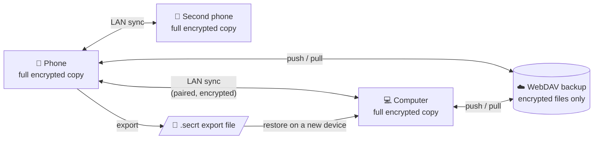
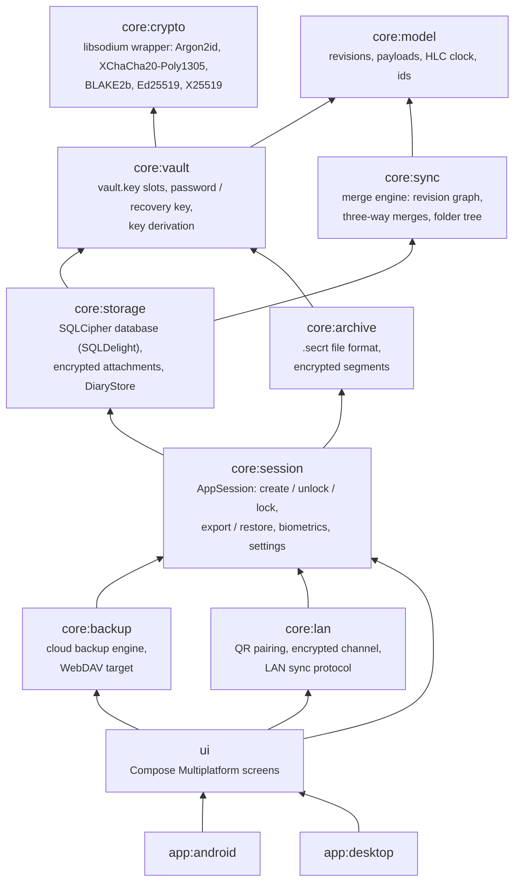
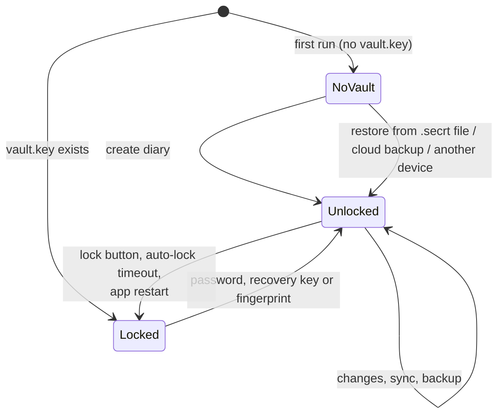

# Overview

## The idea in one paragraph

Every device holds a **complete, encrypted copy** of the diary and works fully offline. No device
is "the main one". Every change is stored as an immutable **revision**, and the screen shows what
those revisions add up to. Syncing two copies (over Wi-Fi, through a cloud backup, or by importing a
file) just means giving each side the revisions it lacks. Each device then works out the same
result on its own, merging concurrent edits with the same deterministic rules everywhere. Because
of that, every transport is "dumb": a WebDAV server stores opaque encrypted files and never needs
to understand them.

## Modules

Kotlin Multiplatform. Everything under `core/` is common code (Android, desktop JVM, later iOS)
except a few small platform pieces: the SQLCipher driver, network addresses, biometrics and HTTP
engines.

Arrows point at dependencies. Some rules that keep this tidy:

- **`core:sync` is pure logic.** It has no I/O and no clock, so the merge rules are tested with
  in-memory revisions.
- **`DiaryStore` (`core:storage`) is the only writer.** It turns user actions into revisions and
  re-derives the visible tables from them. Other modules read revisions from it and hand
  received ones back through `applyRemote`.
- **Every transport goes through the same two calls:** `revisionsSince(versionVector)` to send and
  `applyRemote(revisions)` to receive. LAN sync, cloud backup and `.secrt` import differ only in
  how the bytes travel.
- **`AppSession` (`core:session`) owns the keys.** It unlocks the vault, opens the database, and
  wipes keys from memory on lock. Transports borrow the open diary through it and never see the
  password.

## What a session looks like

On unlock, `AppSession`:
1. reads `vault.key` and uses the password (or recovery key, or the biometric-wrapped key) to get
   the **data key**;
2. derives the database, attachment and archive keys from it (see [security.md](security.md));
3. opens the SQLCipher database and runs any pending schema migrations;
4. hands the UI a `DiaryStore`.

On lock it closes the database and overwrites every key in memory with zeros. The auto-lock
timeout is set in Settings.

## What is stored where

On Android, files are in the app's private storage (`files/vault/…`, plus the database in
`databases/`). Auto-backup is off. On the desktop, everything is in one data directory:
`~/Library/Application Support/secrt` on macOS, or wherever `SECRT_DATA_DIR` or
`-Psecrt.dataDir` points.

| File | Contents | Encrypted? |
|---|---|---|
| `vault/vault.key` | Diary id, key slots (the data key wrapped by the password and by the recovery key), Argon2 parameters, key-check value | The data key inside is wrapped; the rest is plain and holds no secrets |
| `secrt.db` | SQLCipher database: revisions, derived entry/folder/label tables, paired devices, this device's identity, backup settings and credentials | Whole file (SQLCipher, AES-256) |
| `vault/blobs/<id>` | Attachments, one file each | XChaCha20-Poly1305 |
| `vault/settings.json` | Auto-lock preferences, readable while locked | Plain, no diary content |
| `files/biometric.key` (Android) | The data key wrapped by a hardware-backed Keystore key that needs a fingerprint | Yes (Keystore AES-GCM) |

## Where to look in the code

| You want to understand… | Start at |
|---|---|
| How a save becomes a revision | `DiaryStore.saveEntry` → `commit` (`core/storage`) |
| How revisions become what you see | `DiaryStore.materialize` → `RecordResolver.resolve` (`core/sync`) |
| Merge rules | `PayloadMergers.kt`, `TextMerge.kt`, `FolderTree.kt` (`core/sync`) |
| Unlocking and keys | `VaultManager`, `VaultKeys` (`core/vault`), `AppSession` (`core/session`) |
| Export / restore | `AppSession.exportTo` / `restore`, `SecrtArchive` (`core/archive`) |
| Cloud backup | `CloudBackup` (`core/backup`) |
| LAN pairing and sync | `LanSync`, `LanHost`, `Handshake`, `SyncExchange` (`core/lan`) |
| App entry points | `SecrtApp.kt` (`ui`), `SecrtApplication` (Android), `Main.kt` (desktop) |
