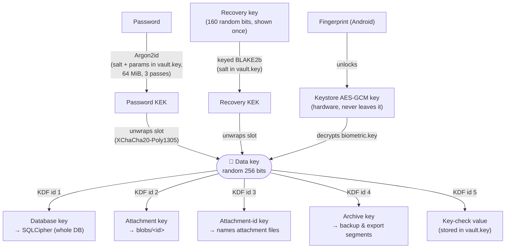

# Security model

## What secrt protects against

| Threat | Protection |
|---|---|
| Someone gets the phone or laptop (lost, stolen, seized) while the diary is locked | Everything is encrypted at rest. Without the password, recovery key or enrolled fingerprint, they only get ciphertext and must guess the password offline against Argon2id |
| The cloud provider (Google, a WebDAV host), or anyone with access to the backup | The backup holds only encrypted files and `vault.key`. Nothing is readable, not even titles or folder names. Tampered files are rejected. Google Drive access is limited to secrt's own hidden folder: secrt can't see the user's other files |
| Someone on the same Wi-Fi | LAN traffic is encrypted and authenticated with fresh keys per connection. Unpaired devices are refused, and pairing needs a one-time secret from a QR code on the other device's screen |
| A stolen `.secrt` export file | Same as a backup: encrypted, and opens only with the password or recovery key |
| Screenshots and the app switcher (Android) | `FLAG_SECURE` hides the app's content |

**Out of scope:**
- Malware on a device while the diary is **unlocked**: it can read what the app can.
- Someone who knows or can guess the password.
- An attacker who already has a copy of an *old* `vault.key` plus the data, after a password
  change (see [Changing the password](#changing-the-password)).

## Keys

Everything hangs off one random 256-bit **data key**. The password never encrypts data directly:
it only unlocks the data key. So changing the password is instant, and many ways in (password,
recovery key, fingerprint) can coexist.

### `vault.key`: the key slots

A small JSON file, the same idea as a LUKS disk header:

- the diary id;
- a **password slot**: salt, Argon2id parameters, and the data key encrypted with the password
  KEK;
- an optional **recovery slot**: salt, and the data key encrypted with the recovery KEK;
- the **key-check value**, which lets biometric unlock confirm that a stored data key belongs to
  this diary;
- the **stamp of the last key-slot change** (`slotsChanged`): when the password or recovery key
  last changed (a hybrid logical clock value whose node is the changing device's id), and that
  device's name, sealed with the archive key. See [Changing the password](#changing-the-password).

Each slot is authenticated encryption bound to the diary id and slot type (AAD
`secrt-slot:<diaryId>:<type>`), so a slot can't be moved to another diary or swapped for another
slot type. A wrong password simply fails to decrypt. Nothing in the file is secret on its own,
which is why it travels in clear inside backups and exports: without the password or recovery
key it reveals nothing.

**The recovery key** is 160 random bits, shown once at setup as 32 characters in 8 groups
(Crockford base32, forgiving about case, dashes and O/0). It is too random to guess, so a fast
keyed hash is enough to derive its KEK. Unlocking with it asks the user to pick a new password
right away. It can be regenerated (the old one stops working) or removed in Settings.

**Biometric unlock (Android only, off unless the user turns it on).** The app creates a
hardware-backed Keystore key (StrongBox when available) that needs a strong (Class 3) biometric
for **every** use. Enrolling a new fingerprint permanently invalidates it. The data key, encrypted
with that Keystore key, sits in `files/biometric.key`. Unlocking decrypts it behind the
fingerprint prompt, then checks it against the key-check value. If the Keystore key has been
invalidated, the feature turns itself off and the password still works.

### What each derived key protects

| Data | Encryption | Notes |
|---|---|---|
| Database (`secrt.db`) | SQLCipher 4 with the database key as a raw key | Everything in it: revisions, titles, bodies, folders, labels, paired devices, backup credentials |
| Attachments | XChaCha20-Poly1305 with the attachment key, AAD = attachment id | File name = keyed BLAKE2b of the content, so the same picture is stored once, and names reveal nothing across diaries. Content is checked against the name when imported |
| Backup and export segments | XChaCha20-Poly1305 with the archive key, AAD = diary id + file name | A segment can't be renamed or moved to another diary undetected |
| LAN connections | XChaCha20-Poly1305 with per-connection keys (X25519 key exchange, Ed25519 identities) | Forward secret: the session keys are thrown away after each connection |

All primitives come from libsodium. Keys are wiped from memory on lock.

## Device identities and pairing

Each device holds an Ed25519 identity key pair (its seed is stored in the encrypted database).
Pairing stores the other device's public key, and later syncs only accept that key. The pairing
QR code carries the address of the device showing it, its public key and a 256-bit one-time secret valid for 5
minutes. Both sides prove they know it during the handshake, so neither can be impersonated by
someone who didn't see the screen. Full details are in
[architecture.md](architecture.md#lan-pairing--sync-corelan-uidevices).

**Sending a diary needs a yes.** A device without a diary can be set up from one that has it, which
sends its whole (encrypted) diary. That copy is as strong as the password, so the sending device
always asks first, once the other device's name is known, and sends nothing on "no", after 90 s
without an answer, or if the diary locks meanwhile:
- the phone scans a code shown by a computer being set up ("Set up from your phone"): *Send a copy of
  your encrypted diary to "&lt;name&gt;"? Only do this with your own device.* This stops someone who
  gets the user to scan *their* code from walking away with the diary to attack offline;
- a new device scans the code this one shows ("Set up from another device"): *"&lt;name&gt;" wants a
  copy of your diary. Send it?* This stops someone who photographs the code within its 5 minutes
  and scans it before the user does.

The name is whatever the other device calls itself, so an attacker can pick a familiar one. What
gives them away is the timing: a question the user didn't expect, or one that shows up while their
own device is still connecting (the code works once, so their own scan then fails).

## Changing the password

Changing the password re-encrypts only the small password slot in this device's `vault.key`. The
data key, and so all data, stays the same. This makes the change instant. Regenerating or removing
the recovery key works the same way, in the same file.

**One password on every device: the most recent change wins.** Each change stamps `vault.key`
(see above). The stamp comes from the device's hybrid logical clock, so it is later than anything
that device had seen, and always later than the stamp it replaces: a change made after taking on
another device's wins over it, even if the clocks disagree. Headers without a stamp (written
before stamps, or rewritten by such a version, which drops the field) count as older than any
stamped one. When two copies meet, the newer one travels to the device with the older one:

- **LAN sync:** right after the hellos, both devices send their `vault.key` through the
  encrypted, authenticated channel, before version vectors.
- **Cloud backup:** a push uploads `vault.key` when this device's stamp is newer than the
  backup's, both in clear (to restore a fresh device) and as `vault.key.sealed`, encrypted with the
  archive key. A pull or sync compares the sealed copy's stamp with its own.

**The device that would change asks first.** *"Your diary's password or recovery key was changed
on "Laptop" (Sun, 8 Nov 2026, 10:05). To sync, this device takes that change on: from the next
time you unlock it, it opens with the password set there."* On a LAN sync this can be either
side: the one that connected or the one listening on its Devices screen; the other one waits, and
if the answer is no, shows "&lt;name&gt; declined: its password would have changed". Only one side
ever asks: the other already has the newer change. A **no** cancels the whole sync: no revision
goes either way (on the cloud: nothing is downloaded or uploaded), and the device keeps its
password. A **yes** installs the newer `vault.key` (atomically: temp file, then rename) once the
sync went through, so an interrupted sync leaves the password as it was and asks again next time.
The diary stays open; from the next unlock it takes the new password, and the old one fails.
Biometric unlock keeps working (it stores the data key, not the password). Restoring a backup or
setting up a device from another one installs the source's `vault.key` without asking: there is
nothing to replace.

**Only authenticated copies are taken on.** The plain `vault.key` on the server is never used for
this: the server could put an old one back (an old password someone knows) or make one up. Copies
taken on arrive sealed with the archive key (cloud: AAD `secrt-archive:<diaryId>:vault.key.sealed`)
or inside the LAN channel, which only this diary's paired devices can open; either way only a
holder of the data key could have produced them. Before installing, the device checks that the copy
is this diary's: same diary id, a key-check value matching *its* data key, and a password slot. A
copy whose stamp is older than this device's is ignored, so a replayed sealed copy can't roll a
device back past what it already has. A damaged or foreign sealed copy stops the pull.

Things to know:
- **Devices running a version from before this** keep their own password, as before. They can't
  LAN-sync with an updated device ("update secrt on the other device"), and a password change made
  on them is unstamped, so it loses against any stamped one.
- **Old copies of `vault.key`** (an old export, a device that never synced again, an earlier
  backup) still open with the old password, and they unlock the same data key. A password change is
  therefore not a way to lock out someone who already has one of those copies. That would need a
  new data key and re-encrypting everything, which is not implemented.
- The device name in the stamp is sealed, so the copies of `vault.key` in clear (backups,
  exports) don't reveal it; the stamp's time and device id are visible there (device ids already
  are, in the backup's file names).
